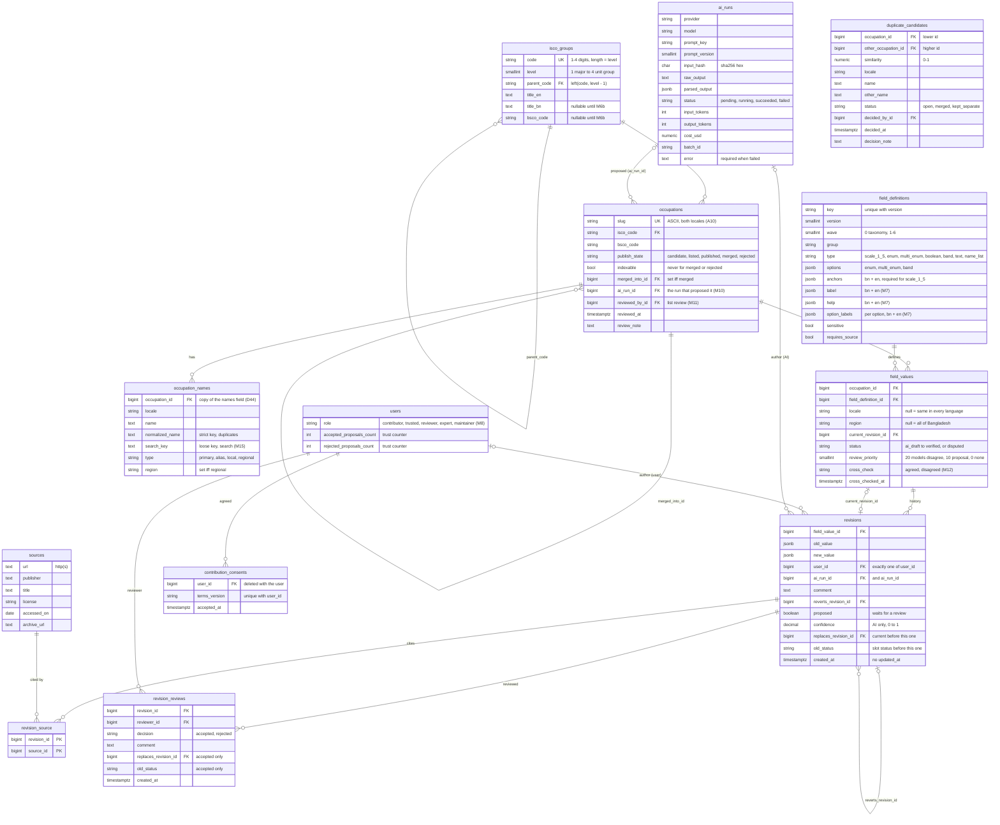

# Data model

The core tables from M4, with the roles and consent from M8. Migrations in `database/migrations/`
are the source of truth; this page explains them. Later milestones add `observations`,
`submissions`, `verification_tasks` and `discussions`.

## Which module owns what

| Module | Tables | Models |
|---|---|---|
| Taxonomy | `isco_groups`, `occupations`, `occupation_names` | `IscoGroup`, `Occupation`, `OccupationName` |
| Knowledge | `field_definitions`, `field_values`, `revisions`, `revision_reviews`, `sources`, `revision_source` | `FieldDefinition`, `FieldValue`, `Revision`, `RevisionReview`, `Source` |
| AiPipeline | `ai_runs` | `AiRun` |
| Community | `contribution_consents` (and `users.role`, trust counters) | `ContributionConsent` (`App\Models\User` stays the auth model) |

A module never reads another module's tables or models. Across modules, rows are linked by a foreign
key, and the model keeps only the id (`FieldValue::$occupation_id`, `Revision::$ai_run_id`).

## Rules the database enforces

Each is a constraint, so it holds even for raw SQL. The tests are in
`tests/Feature/{Taxonomy,Knowledge}/`.

- **Append-only history (rule 5, D2).** A trigger rejects `UPDATE`, `DELETE` and `TRUNCATE` on
  `revisions`, `revision_reviews` and `revision_source`. The `AppendOnly` model trait throws first.
  `migrate:rollback` still works, because `DROP TABLE` is not blocked.
- **One author per revision.** `num_nonnulls(user_id, ai_run_id) = 1`. Authors can't be deleted while
  they have revisions (foreign keys `RESTRICT`).
- **One value slot** per occupation × field definition × locale × region, with `NULLS NOT DISTINCT`, so
  two "all regions" rows can't coexist.
- **Statuses and types** are check constraints, not Postgres enum types, so a later value is a small
  migration. PHP enums mirror them: `FieldStatus`, `FieldType`, `ReviewDecision`, `PublishState`,
  `NameType`, `AiRunStatus`, `DuplicateStatus`, `CrossCheck`.
- **ISCO codes**: digits only, length = level, and the parent is the code minus its last digit.
- **Merges**: `merged_into_id` is set if and only if `publish_state = 'merged'`. A merged occupation is
  never `indexable` and never points to itself.
- **Cross-check (M12)**: `cross_check` and `cross_checked_at` are set together (PLAN D50).
- **List review (M11)**: `reviewed_by_id` and `reviewed_at` are set together; a rejected occupation
  is never indexable. `duplicate_candidates` holds each pair once (`occupation_id < other_occupation_id`,
  unique), and a decided pair has `decided_by_id` and `decided_at`; a GIN trigram index on
  `occupation_names.normalized_name` serves the detector (PLAN D47).
- **Names**: one primary name per occupation and locale. Regional names carry a region; others don't.
- **Field definitions**: `key` + `version` is unique. A change of meaning, options or anchors is a new
  version. 1–5 scales need anchors in `bn` and `en`; choice fields need options.
  The definitions come from `data/fields/*.yaml` through `atlas:fields:sync`; see
  [fields.md](fields.md) and PLAN D31.

## The write path (M5)

Rules that need context the database doesn't have live in `Knowledge\Actions`, the only code that
writes `field_values`, `revisions` and `revision_reviews` (`Arch/KnowledgeWritePathTest`). Each action
runs in one transaction and first locks the slot's row (`SELECT … FOR UPDATE`), so two writes to one
slot run one after the other (`ConcurrentWriteTest`).

| Action | What it does |
|---|---|
| `RecordRevision` | Validates the value (`ValidateFieldValue`), checks `requires_source` and the AI confidence, then writes a revision. An AI write on a `verified` value, a contributor's write, and any person's write on a sensitive field is a **proposal**: the current value stays and the slot's `review_priority` rises. Any other write becomes current: an AI write as `ai_draft`, a person's as `community_supported` (O11); either as `sourced` with a source. |
| `ChangeStatus` | Moves a slot along the transition table below, if the person's role allows the target (D36). AI runs can't. |
| `ReviewRevision` | Accepts or rejects a pending proposal (`revision_reviews`); reviewers and above, never their own proposal (the maintainer excepted, A13). Accepting makes it current and `verified`. Counts the outcome on the author. |
| `RevertRevision` | Undoes the current value with a new revision that restores the replaced value, its sources and its status. Trusted and above; a verified or sensitive value needs a reviewer. |

**Values.** `null` and `"unknown"` both mean "not known" and are stored as null; `requires_source`
applies only to a known value. A 1–5 scale is a whole number; enum and band values are one of the
definition's options; a multi-enum is a non-empty list of distinct options. Text needs a supported
locale; every other type is the same in every language, so it has none (D22). A name list (D44) has
a locale too, and no region: a list of `{name, type}` with exactly one `primary`, no name twice
(compared without case and extra spaces), and a division key on each `regional` name.

**Names.** The current value of the `names` field in each language is copied into
`occupation_names` (the search table) whenever it changes: a direct write, an accepted proposal or a
revert raises `Knowledge\Events\CurrentValueChanged`, and `Taxonomy\Actions\SyncOccupationNames`
rewrites that occupation's rows for the language in the same transaction. Search reads only the
copy; the history lives in `revisions`.

**Status moves** (`FieldStatus::allowedTargets`, D27). A value moves up the ladder or to `disputed`;
a disputed value goes back up once checked again. `ai_draft` is never a target: only an AI revision
sets it. `sourced` needs a source on the current value.

| From | To |
|---|---|
| `ai_draft` | `sourced`, `community_supported`, `verified`, `disputed` |
| `sourced` | `community_supported`, `verified`, `disputed` |
| `community_supported` | `verified`, `disputed` |
| `verified` | `disputed` |
| `disputed` | `sourced`, `community_supported`, `verified` |

**Pending and replaced.** A proposal is pending while it has no review. The revision that was current
before, and the slot's status then, are kept where the change happened: on the revision for a direct
write, on the accepting review for a proposal. A revert reads them from there.

Times are stored as `timestamptz` (UTC) and shown in Asia/Dhaka.
