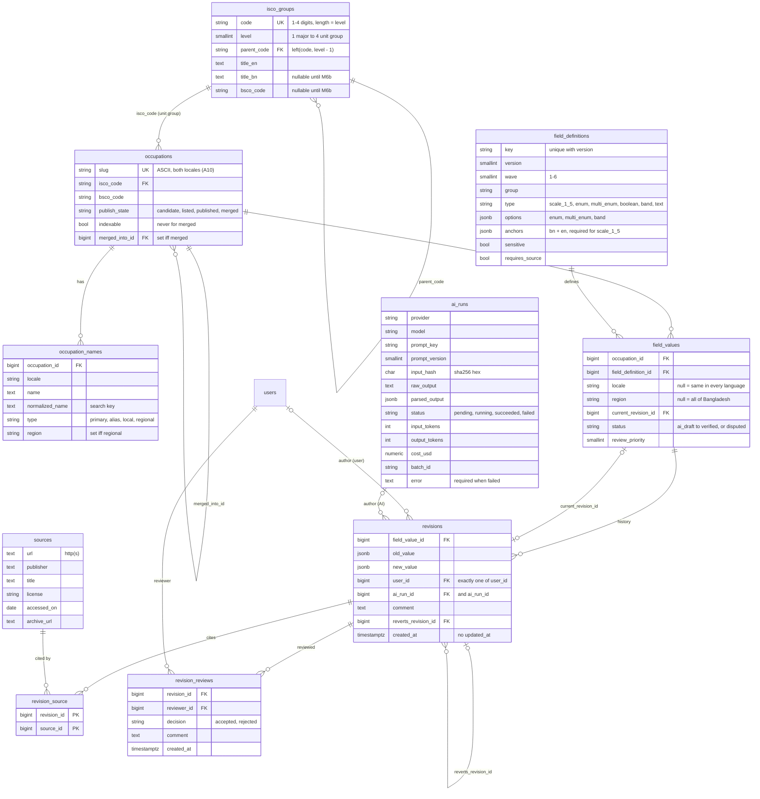

# Data model

The core tables from M4. Migrations in `database/migrations/` are the source of truth; this page
explains them. Later milestones add `observations`, `submissions`, `verification_tasks` and
`discussions`.

## Which module owns what

| Module | Tables | Models |
|---|---|---|
| Taxonomy | `isco_groups`, `occupations`, `occupation_names` | `IscoGroup`, `Occupation`, `OccupationName` |
| Knowledge | `field_definitions`, `field_values`, `revisions`, `revision_reviews`, `sources`, `revision_source` | `FieldDefinition`, `FieldValue`, `Revision`, `RevisionReview`, `Source` |
| AiPipeline | `ai_runs` | `AiRun` |

A module never reads another module's tables or models. Across modules, rows are linked by a foreign
key, and the model keeps only the id (`FieldValue::$occupation_id`, `Revision::$ai_run_id`).

## Rules the database enforces

Each is a constraint, so it holds even for raw SQL. The tests are in
`tests/Feature/{Taxonomy,Knowledge}/`.

- **Append-only history (rule 5, D2).** A trigger rejects `UPDATE`, `DELETE` and `TRUNCATE` on
  `revisions`, `revision_reviews` and `revision_source`. The `AppendOnly` model trait throws first.
  `migrate:rollback` still works, because `DROP TABLE` is not blocked.
- **One author per revision.** `num_nonnulls(user_id, ai_run_id) = 1`. Authors can't be deleted while
  they have revisions (foreign keys `RESTRICT`).
- **One value slot** per occupation × field definition × locale × region, with `NULLS NOT DISTINCT`, so
  two "all regions" rows can't coexist.
- **Statuses and types** are check constraints, not Postgres enum types, so a later value is a small
  migration. PHP enums mirror them: `FieldStatus`, `FieldType`, `ReviewDecision`, `PublishState`,
  `NameType`, `AiRunStatus`.
- **ISCO codes**: digits only, length = level, and the parent is the code minus its last digit.
- **Merges**: `merged_into_id` is set if and only if `publish_state = 'merged'`. A merged occupation is
  never `indexable` and never points to itself.
- **Names**: one primary name per occupation and locale. Regional names carry a region; others don't.
- **Field definitions**: `key` + `version` is unique. A change of meaning, options or anchors is a new
  version. 1–5 scales need anchors in `bn` and `en`; choice fields need options.

## What the application checks instead

From M5, `Knowledge\Actions\RecordRevision` checks:

- that a value fits its field definition (type, options, the 1–5 range, `"unknown"`)
- the `requires_source` rule
- that AI never replaces a `verified` value
- status transitions

Those rules need context the database doesn't have.

Times are stored as `timestamptz` (UTC) and shown in Asia/Dhaka.
